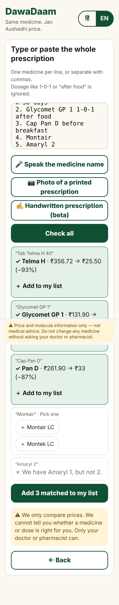
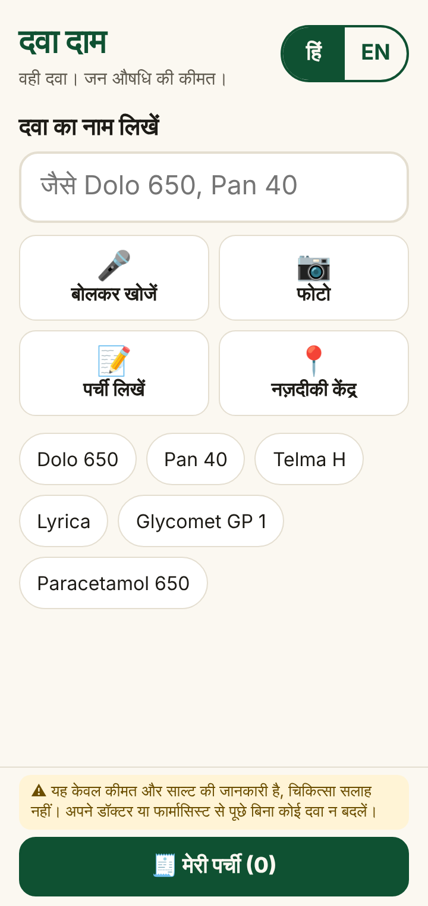
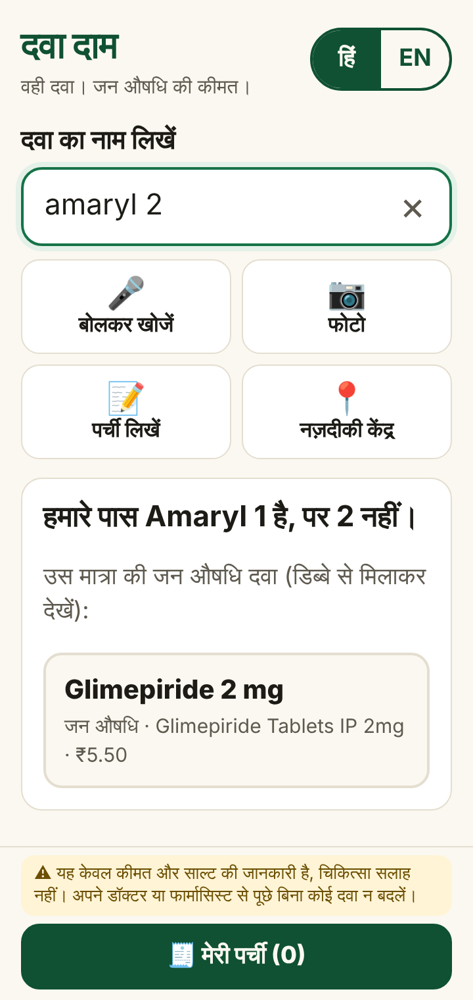
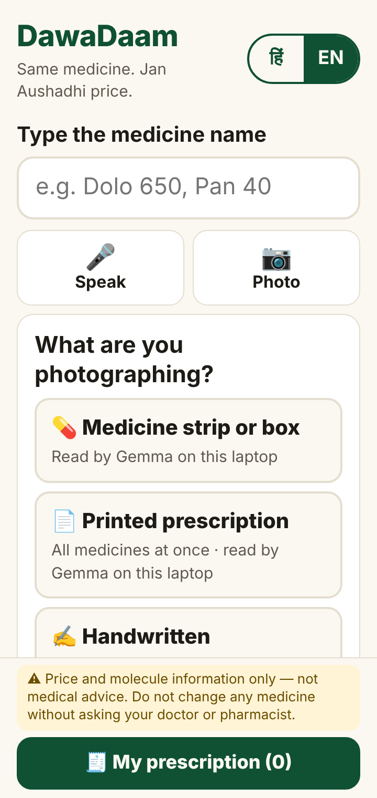
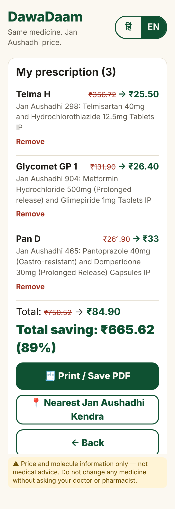
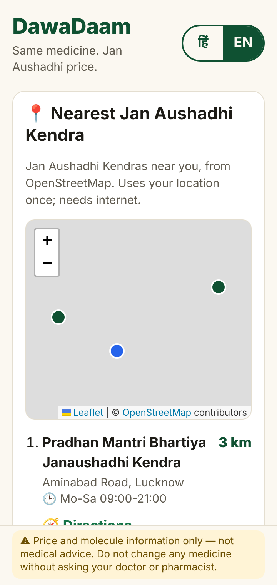
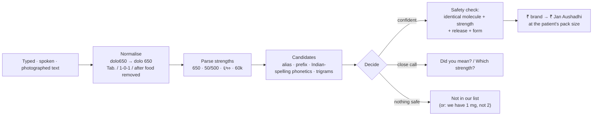

<div align="center">

# DawaDaam · दवा दाम

### Same medicine. Jan Aushadhi price.

**Type, say or photograph the medicine on your prescription, and see what the identical Jan Aushadhi generic costs, before you pay.**

[](https://github.com/GamerxD01/Dawa-Daam/actions/workflows/ci.yml)
[](https://gamerxd01.github.io/Dawa-Daam/)
[](LICENSE)


**[▶ Open the app](https://gamerxd01.github.io/Dawa-Daam/)** · [How it works](#how-it-works) · [Gemma 4](#gemma-4-on-our-own-laptop) · [Run it yourself](#run-it-yourself) · [Data](#data) · [Contribute](CONTRIBUTING.md)

&nbsp;
&nbsp;


</div>

> [!IMPORTANT]
> **Price and molecule information only, not medical advice.** DawaDaam never tells anyone to switch medicines and never comments on a dose. Always ask your doctor or pharmacist before changing any medicine. This line is on every screen of the app.

---

## The problem

A patient is handed a prescription of brand names, takes it to a chemist, and pays what they are told. For most of those medicines, an **identical generic** (same molecule, same strength, same form) is sold at a **Jan Aushadhi Kendra** for a fraction of the price. The patient can't read the molecule off the prescription, and won't argue at the counter.

**DawaDaam puts the saving in front of them, in Hindi, on a cheap phone, with no internet.**

| Brand (pack) | Brand MRP | Jan Aushadhi, same pack | Saving |
|---|---:|---:|---:|
| Lyrica 75 (14 capsules) | ₹841.87 | **₹30.80** | **96%** |
| Rosuvas 10 (15 tablets) | ₹375.00 | **₹18.70** | **95%** |
| Galvus 50 (15 tablets) | ₹371.25 | **₹20.00** | **95%** |
| Telma H (15 tablets) | ₹356.72 | **₹25.50** | **93%** |
| Pan 40 (15 tablets) | ₹192.80 | **₹18.15** | **91%** |
| Garyfex 180 (10 tablets) *(MRP read off our own strip)* | ₹175.00 | **₹37.40** | **79%** |

Across all **63 curated brands**, the **median saving is 80%** (range 43–96%). We show small savings honestly too: Ecosprin 75 saves 43%.

## What it does

<table>
<tr>
<td width="33%" valign="top"><br><b>Hindi first, one hand.</b> One search box, four big tiles, the disclaimer always visible, and "my prescription" in the thumb zone.</td>
<td width="33%" valign="top"><br><b>Never guesses.</b> No strength typed? "Which strength is on the strip?" Unclear? "Did you mean…?"</td>
<td width="33%" valign="top"><br><b>Says what it doesn't know.</b> "We have Amaryl 1, not 2", then shows the Jan Aushadhi 2 mg as information only.</td>
</tr>
<tr>
<td valign="top"><br><b>📷 Photo:</b> strip/box or printed prescription read by <b>Gemma 4 on our laptop</b>; handwritten (beta) by Gemini, only if enabled.</td>
<td valign="top"><br><b>Whole prescription:</b> paste, type, speak or photograph it. Dosage like <code>1-0-1 x 5 days</code> is stripped, never interpreted. You get a total saving.</td>
<td valign="top"><br><b>📍 Nearest Kendra</b> from OpenStreetMap: distance, map, directions, opening hours. Linked from every result.</td>
</tr>
</table>

### Against the problem statement

| The brief asked for | DawaDaam |
|---|---|
| Enter a brand **or** a molecule → generic name, strength, indicative generic vs branded price | ✅ Both: `Pan 40` → Pantoprazole 40 mg GR, ₹192.80 → ₹18.15; `paracetamol 650` → Jan Aushadhi 511 plus the brands we know |
| Make the saving the headline (`₹240 → ₹28`) | ✅ A 56 px number, at the patient's own pack size, with the per-tablet price underneath |
| Tolerate misspellings, missing strengths, half-read words | ✅ `lirika`, `rozuvas`, `alegra`, `dolo650`, `DOLO-650 TAB`, `pantop`, `६५०`. Covered by 234 tests |
| A clear disclaimer, and mean it | ✅ On every screen; the app never says "switch", "replace" or "use instead" |
| ➕ Photograph the strip or box | ✅ Gemma 4 E2B, local. Measured on our own strips (below) |
| ➕ Whole prescription with a total saving | ✅ Typed, pasted, spoken, or a photo of a **printed** prescription |
| ➕ Nearest Jan Aushadhi Kendra | ✅ OpenStreetMap / Overpass, with a Google Maps fallback |
| ➕ Printable sheet for the counter | ✅ Bilingual sheet: print, save as PDF, or share on WhatsApp |
| ➕ Pill identifier by imprint | ❌ **Deliberately not built.** There is no reliable open Indian imprint database, and a wrong pill ID is dangerous |
| Never generate drug information with a language model | ✅ Models only **read text** and **pick from our list**. Every fact shown comes from data we ship |
| OCR on handwriting is hard: keep typing as the path that always works | ✅ Typing always works. Handwriting is an opt-in beta with extra safeguards |
| Curate 200 drugs well | ✅ **212 hand-checked rows** (149 Jan Aushadhi products + 63 brands), each brand with a source and date |
| Cheap phone, bad signal | ✅ **≈33 KB gzipped** app with the data inside; **works in aeroplane mode**; no web fonts; 48 px+ tap targets |
| Open source, honest commits | ✅ Apache-2.0, CONTRIBUTING.md, small commits from the build window, CI on every push |

## How it works



**The matcher is our own** (`src/match/`, no fuzzy-search library). It combines Damerau-Levenshtein distance, trigram overlap, prefix matching for half-read words, and a phonetic key tuned for Indian spellings (`ph/f`, `z/s`, `c/k`, `v/w`, `y/i`, doubled letters: `lirika` = `lyrica`, `rozuvas` = `rosuvas`).

**Safety by design**, enforced in code and by tests:

- A brand gets a Jan Aushadhi price **only** if every ingredient matches on **molecule, strength, unit and release type** (plain / SR-ER-PR / gastro-resistant), **and** the dosage form is the same. SR never matches plain, a combination never matches a single molecule, and 25 mg never matches 50 mg (`src/match/equivalence.ts`).
- **Letter suffixes are different medicines.** `Pan` ≠ `Pan D`, `Telma` ≠ `Telma H`, `Montair` ≠ `Montair LC`. A suffix-less query asks instead of guessing.
- **A strength we don't have is reported, not swapped.** "We have Amaryl 1, not 2."
- **An unreadable word never gives a confident answer.** `Cap Pan [?] 40` asks "Pan 40 or Pan D?".
- **Dosage instructions are removed, never interpreted.** The app has no opinion on `1-0-1`.
- **Only lines with both prices count towards a total.** Nothing is estimated.

## Gemma 4, on our own laptop

| | |
|---|---|
| **Model** | **Gemma 4 E2B** (`gemma4:e2b`): open weights, Apache-2.0, image input |
| **Where it runs** | Our laptop (Windows, **RTX 3050 4 GB**, `ollama ps` shows 100% GPU) via **Ollama**. Photos go from the phone to that laptop over local Wi-Fi and never leave it |
| **What it is asked** | **Job 1:** *transcribe* the printed text on a strip, box or printed prescription (JSON, temperature 0). **Job 2:** *choose one id* from the candidate list **our** matcher built from that text, or `null`. Enforced with a JSON-schema `enum`, so it cannot return a product we didn't offer |
| **What it is never asked** | Dosage, price, molecule, side effects, alternatives, or any free text shown to a patient |
| **Why Gemma here** | Foil glare, curved strips and mixed fonts defeat plain OCR on brand names. A small vision model reads layout and noisy text, runs locally, and keeps prescription photos private |

**Measured on six of our own strip photos** (phone camera, ordinary light, some with pen marks):

| Strip | Time | Brand read | Strength read | What the app did |
|---|---:|:---:|:---:|---|
| Garyfex-180 (fexofenadine 180) | 9.2 s | ✗ *"Ganytex-180"* | ✓ | Our fuzzy matcher still offered **Garyfex 180** → patient confirms → ₹175 → ₹37.40 |
| Giorax-25 (hydroxyzine 25) | 10.3 s | ✓ | ✓ | "We have hydroxyzine 10 mg, not 25" |
| Panced-DSR (pantoprazole + domperidone) | 13.4 s | ✓ | ✗ | Composition line matched Jan Aushadhi 465 |
| Lactopen (lactic acid bacillus) | 7.3 s | ✓ | – | Matched Jan Aushadhi 196 |
| ?PRET-8 (name covered by pen) | 10.3 s | – | – | No candidates → asked to type |
| Nutricion-5G (a nutraceutical) | 38.6 s\* | ✗ | – | No candidates → "not in our list". Correct: it isn't a medicine |

\* includes loading the model onto the GPU; warm reads took 7–13 s. **Gemma alone read 3/5 brands and 2/5 strengths**, which is why its output is only a hint to our deterministic matcher, and the patient always confirms. **In no case did the app show a wrong medicine.** These exact Gemma outputs are kept as regression tests (`src/photo.test.ts`). Full details: [docs/GEMMA.md](docs/GEMMA.md).

**Optional Gemini fallback (off by default).** If Gemma's read gives nothing we can match, or the patient says "not this", the app *offers* a "Try Gemini" button to re-read the same photo with Google Gemini (`gemini-3.6-flash`, online), and **Gemma still makes the final pick**. Handwritten prescriptions (beta) are read only by Gemini, which returns just the medicine names and strengths (no patient details): no "add all", every medicine confirmed individually, unclear words marked `[?]`. Without a Gemini key, none of this appears and the app is pure Gemma, fully local.

## Run it yourself

**Just use it:** open **https://gamerxd01.github.io/Dawa-Daam/**, then *Add to Home screen*. After the first visit it works with no signal.

**Run locally** (Node 18+):

```bash
git clone https://github.com/GamerxD01/Dawa-Daam.git
cd Dawa-Daam
npm install
npm run dev          # http://localhost:5173 · phone on the same Wi-Fi: http://<laptop-ip>:5173
npm test             # data build + 234 tests
npm run build        # production build in dist/
```

**With photo reading (Gemma 4 on your machine):**

```bash
ollama pull gemma4:e2b   # ~7 GB, once
npm run demo             # starts the Gemma bridge + the app, prints the address for your phone
```

The 📷 tile appears only when the bridge answers; typing never depends on it. To use the live site with your laptop's Gemma, open `https://gamerxd01.github.io/Dawa-Daam/?gemma=http://localhost:8000` on that laptop (Chrome will ask to allow local access).

**Optional: Gemini fallback + handwriting beta.** Off unless *you* set a key on *your* bridge ([get one at Google AI Studio](https://aistudio.google.com/apikey); never commit it):

```powershell
$env:GEMINI_API_KEY = "your-key"     # PowerShell  ·  macOS/Linux: export GEMINI_API_KEY=your-key
npm run demo
```

**Measure Gemma on your own photos:** `npm run gemma:eval -- path/to/photos` (optional `expected.csv`: `file,brand,strength`).

## Data

Everything is bundled in the repo and shipped inside the app.

| File | Rows | What |
|---|---:|---|
| [`data/src/janaushadhi.csv`](data/src/janaushadhi.csv) | 143 | Jan Aushadhi products: PMBI drug code, MRP, pack, and a **structured composition** (molecule, strength and release type per ingredient) |
| [`data/src/brands.csv`](data/src/brands.csv) | 63 | Curated brands: composition, pack, **listed MRP**, **source URL and date**, expected Jan Aushadhi code |
| [`data/src/molecules.csv`](data/src/molecules.csv) | 84 | Canonical names, synonyms (`frusemide`, `amoxycillin`, `thyroxine`), Hindi names |
| [`data/src/combo_aliases.csv`](data/src/combo_aliases.csv) | 9 | Combination nicknames (`amoxyclav`, `panto d`) |

`npm run data` validates everything and fails the build on an unknown molecule, a malformed strength, a missing price or a missing source. A test checks that **every brand maps to its expected Jan Aushadhi code** and that **every brand is found by its own name**. Rows we couldn't fully confirm are marked `verified=n` and show a "check the box" warning. Sources and cleaning decisions: [docs/DATA.md](docs/DATA.md).

## Built for the person with the cheap phone

- **≈33 KB gzipped** for the whole app, including all the data. The map library loads only on the Kendra screen.
- **Works offline:** a service worker precaches the app on the first visit. Tested by reloading in aeroplane mode.
- **Hindi by default**, with "साल्ट" (salt) as chemists say it. One tap switches to English. No web fonts, because Android's built-in Devanagari font works offline.
- **One hand:** 48 px+ targets, 22 px input, the main actions in the bottom thumb zone. Dark mode follows the phone.
- **No account, no tracking.** The list lives on the phone. Location is used once, only when you ask for a Kendra.

## Project layout

```
data/src/              curated CSVs: the single source of truth
scripts/build-data.mjs CSV → validated src/generated/drugs.json
scripts/demo.mjs       one-command local demo (Gemma bridge + app)
src/match/             normalise · parse · phonetic · similarity · equivalence · search · prescription · voice (+ tests)
src/ui/                result card, choices, prescription, photo, Kendra map, list, counter sheet
src/kendra.ts          OpenStreetMap / Overpass lookup (+ tests)
src/photo.ts           client side of the photo flow
server/                zero-dependency Gemma bridge + evaluation script
public/sw.js           offline service worker
docs/                  DATA.md · GEMMA.md · screenshots · sample printed prescription
```

## Limits, honestly

- **Prices are indicative MRPs**, captured by hand on 20–21 Oct 2026. Prices change and pharmacies discount.
- **Coverage:** 63 brands so far. Molecule search covers all 149 Jan Aushadhi products in the dataset; anything else gets "not in our list yet" and a link to request it.
- **"Same molecule & strength" is not a medical judgement.** Bioequivalence and the decision to switch belong to the doctor and pharmacist.
- **Gemma misreads** (see the table above), so the patient always confirms. Handwriting is only an opt-in Gemini beta and can be wrong.
- **Kendra finder** depends on OpenStreetMap coverage, which volunteers build and is incomplete; it needs internet.
- **Salts** (e.g. metoprolol succinate vs tartrate) aren't distinguished, because the PMBI list doesn't distinguish them.

## Roadmap

- Grow to 500+ brands with pharmacists through the [add-a-medicine issue form](https://github.com/GamerxD01/Dawa-Daam/issues/new?template=add-medicine.yml)
- NPPA ceiling prices as a third reference price
- Bundle the official Kendra list for offline lookups
- More Indian languages (the UI strings are already separated in `src/i18n.ts`)

## Contributing

Adding a medicine is **one CSV row with a source link**, and no code. Read [CONTRIBUTING.md](CONTRIBUTING.md) for the data rules (no AI-generated rows, every price sourced, exact composition) and the [Code of Conduct](CODE_OF_CONDUCT.md).

## Credits

- **Data:** [Pradhan Mantri Bhartiya Janaushadhi Pariyojana (PMBI)](https://janaushadhi.gov.in) product list and MRPs. Brand MRPs from public listings on [Truemeds](https://truemeds.in), [PharmEasy](https://pharmeasy.in) and [1mg](https://www.1mg.com) (URL and date on every row). Garyfex 180's MRP was read off a strip we photographed.
- **Models:** [Gemma 4](https://ai.google.dev/gemma) by Google DeepMind (Apache-2.0), served with [Ollama](https://ollama.com) (MIT). Optional: [Gemini API](https://ai.google.dev/gemini-api/docs) (Google, cloud), only when the bridge owner sets their own key.
- **Maps:** © [OpenStreetMap](https://www.openstreetmap.org/copyright) contributors (ODbL), via the [Overpass API](https://overpass-api.de); drawn with [Leaflet](https://leafletjs.com) (BSD-2-Clause).
- **Libraries:** [Preact](https://preactjs.com) (MIT), [Vite](https://vite.dev) (MIT), [Vitest](https://vitest.dev) (MIT), [TypeScript](https://www.typescriptlang.org) (Apache-2.0). Screenshots and UI checks with [Playwright](https://playwright.dev) (Apache-2.0).
- **Speech:** the browser's built-in Web Speech API.
- **AI assistance:** code and docs were written with help from Claude (Anthropic) during the hackathon build window. Gemma 4 is the model inside the product.

## Licence

[Apache-2.0](LICENSE), the same licence as Gemma 4.
