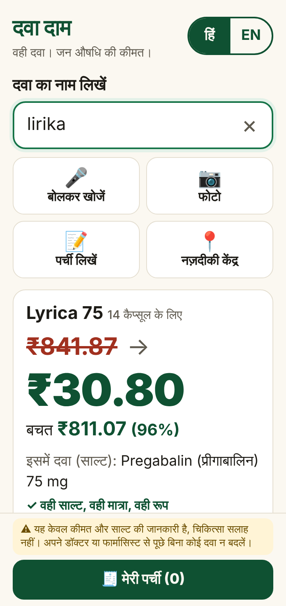
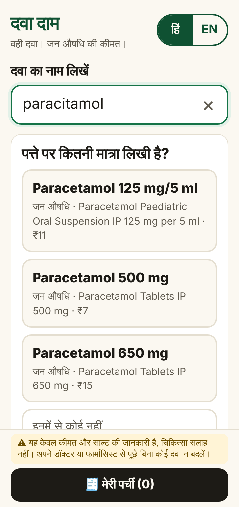
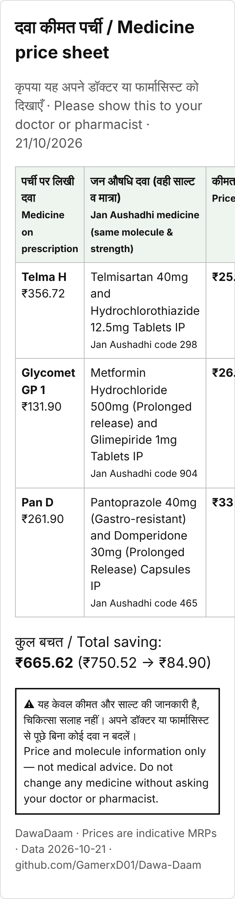

# DawaDaam · दवा दाम

**Same medicine. Jan Aushadhi price.** Type (or photograph) the brand name on a prescription or strip and see, in one big number, what the identical Jan Aushadhi generic costs: same molecule, same strength, same form.

> **Pan 40** (15 tablets) **~~₹192.80~~ → ₹18.15** · you save ₹174.65 (91%)
> **Lyrica 75** (14 capsules) **~~₹841.87~~ → ₹30.80** · you save ₹811.07 (96%)

Built for the patient at the chemist counter: Hindi first, one hand, a cheap Android phone, **no internet needed**.

> ⚠️ **Price and molecule information only, not medical advice.** DawaDaam never tells anyone to switch medicines. Ask your doctor or pharmacist before changing any medicine.

<p align="center">  </p>

## What it does

| | |
|---|---|
| 🔎 **Search by brand or molecule** | `dolo`, `Pan 40`, `telma h`, `paracetamol 650`, `amoxyclav 625` |
| ✍️ **Tolerates bad input** | misspellings (`lirika`, `rozuvas`, `alegra`), half-read words (`pantop`), missing strengths, `DOLO-650 TAB`, Devanagari digits (`६५०`) |
| 💰 **The saving is the headline** | brand price → Jan Aushadhi price at the **same pack size**, plus per-tablet prices |
| 🛑 **Never guesses** | ambiguous input → "Did you mean?"; no strength → "Which strength?"; strength we don't have → "We have Amaryl 1, not 2" |
| 🧾 **Whole prescription** | add several medicines, see the total saving |
| 🖨 **Counter sheet** | bilingual printable / PDF / WhatsApp sheet to hand to the doctor or chemist |
| 📷 **Photo of a strip (optional)** | Gemma 4 running on your own laptop reads the printed name; you confirm |
| 📴 **Offline** | the whole app and data (~23 KB gzipped) are cached by a service worker |
| 🇮🇳 **Hindi + English** | Hindi by default, "साल्ट" (salt) as chemists say it |

## Try it

**Live:** https://gamerxd01.github.io/Dawa-Daam/ (installable as an app; works in aeroplane mode after the first visit)

**Run locally** (Node 18+):

```bash
git clone https://github.com/GamerxD01/Dawa-Daam.git
cd Dawa-Daam
npm install
npm run dev        # http://localhost:5173 — on your phone use http://<laptop-ip>:5173
npm test           # 119 tests, including the bad-input suite
npm run build      # production build in dist/
```

**Optional: photo reading with Gemma 4** (needs [Ollama](https://ollama.com)):

```bash
ollama pull gemma4:e2b
npm run demo       # starts the Gemma bridge + the app and prints the address for your phone
```

(Or run them separately: `npm run gemma` for the bridge on :8000, and `npm run dev`, which proxies `/gemma` to it.)

The 📷 button appears only when the bridge is reachable. Typing always works without it.

## How it works

```
 typed text ──► normalise ──► parse strength ──► candidates ──► score ──► decide ──► safety check ──► price
                (dolo650 →      (650, 50/500,     (alias,        (edit    (match /     (identical
                 dolo 650)        ६५०, 60k)        prefix,        distance, did-you-     composition
                                                   phonetic,      phonetic, mean /       + form, or
                                                   trigram)       strength) strength /   no price)
                                                                            none)
```

- **Data** (`data/src/*.csv` → `npm run data` → `src/generated/drugs.json`): 141 Jan Aushadhi products with structured compositions, 37 curated brands, 82 molecules with synonyms and Hindi names. The build fails on any unknown molecule, missing price or source. See [docs/DATA.md](docs/DATA.md).
- **Matcher** (`src/match/`): our own, no fuzzy-search library. Damerau-Levenshtein, trigram overlap, prefix matching for half-read words, and a phonetic key tuned for Indian spellings (`ph/f`, `z/s`, `c/k`, `v/w`, `y/i`, doubled letters). Letter suffixes (`D`, `H`, `AM`, `LC`, `P`) are treated as different products, because they are.
- **Safety equivalence** (`src/match/equivalence.ts`): a brand gets a Jan Aushadhi price **only** if every component matches on molecule, strength, unit and release type (IR / SR-ER-PR / gastro-resistant) **and** the dosage form is the same. SR never matches plain, a combination never matches a single molecule, 25 mg never matches 50 mg. Where Jan Aushadhi lists duplicates, the cheapest is shown.
- **Prices**: generic price = cheapest Jan Aushadhi per-unit price × the brand's pack size, so the comparison is for the strip in the patient's hand. Only lines with both prices count towards a total. Nothing is estimated.

## Gemma 4 (Best Use of Gemma 4 track)

| | |
|---|---|
| **Model** | Gemma 4 **E2B** (`gemma4:e2b`), open weights, Apache-2.0 |
| **Where it runs** | on our own laptop through Ollama (tested on an RTX 3050 4 GB, 100% GPU). Prescription photos never leave the user's machine |
| **What it is asked** | **(1)** *Transcribe* the printed text on a strip/box, as JSON, temperature 0. **(2)** *Choose one id* from the candidate list our matcher built from that text, or `null`, enforced with a JSON-schema `enum` |
| **What it is never asked** | dosage, price, molecule, side effects, alternatives, or any free text shown to the patient |
| **Why Gemma here** | foil glare, curved strips and mixed fonts defeat plain OCR on brand names; a small vision model handles layout and noisy text and runs locally |
| **What it gets wrong** | handwriting (we don't attempt it), heavy glare, confusing batch numbers with strength, occasional invented letters. So its output only feeds our deterministic matcher and the patient confirms |

Measured results and prompts: [docs/GEMMA.md](docs/GEMMA.md). Bridge: [`server/gemma-bridge.mjs`](server/gemma-bridge.mjs). Evaluation script: [`server/eval.mjs`](server/eval.mjs).

## Project layout

```
data/src/            curated CSVs (Jan Aushadhi, brands, molecules, combo nicknames)
scripts/build-data   CSV → validated JSON
src/match/           normalise · parse · phonetic · similarity · equivalence · search (+ tests)
src/ui/              result card, choices, list, counter sheet, photo
src/photo.ts         client side of the Gemma flow
server/              Gemma bridge (zero dependencies) + evaluation script
public/sw.js         offline service worker
```

## Limits we know about

- **Indicative prices.** Brand MRPs were captured by hand from public pharmacy listings on the date shown on each card; Jan Aushadhi prices come from the PMBI product list. Prices change.
- **Coverage.** 37 brands are curated so far. Molecule search covers all 141 Jan Aushadhi products in the dataset. Anything else gets an honest "not in our list yet".
- **Salts** (e.g. metoprolol succinate vs tartrate) are not distinguished in the Jan Aushadhi list; noted per row where it matters.
- **Rows marked unverified** (e.g. a release type not stated on the source page) show a warning on the card.

## Contributing

Adding a medicine is one CSV row with a source link. See [CONTRIBUTING.md](CONTRIBUTING.md). Please read the [Code of Conduct](CODE_OF_CONDUCT.md).

## Credits

- **Data:** [Pradhan Mantri Bhartiya Janaushadhi Pariyojana (PMBI)](https://janaushadhi.gov.in) product list and MRPs. Brand MRPs: public listings on [Truemeds](https://truemeds.in), [PharmEasy](https://pharmeasy.in) and [1mg](https://www.1mg.com) (URL and date per row in `data/src/brands.csv`).
- **Model:** [Gemma 4](https://ai.google.dev/gemma) by Google DeepMind (Apache-2.0), served with [Ollama](https://ollama.com) (MIT).
- **Libraries:** [Preact](https://preactjs.com) (MIT), [Vite](https://vite.dev) (MIT), [Vitest](https://vitest.dev) (MIT), [TypeScript](https://www.typescriptlang.org) (Apache-2.0). UI screenshots and tests use [Playwright](https://playwright.dev) (Apache-2.0).
- **Fonts:** none downloaded. The system's Devanagari fonts (Noto Sans Devanagari on Android) keep it light and offline.
- **AI assistance:** code and docs were written with help from Claude (Anthropic) during the hackathon window. Gemma 4 is the model inside the product.

## Licence

[Apache-2.0](LICENSE), the same licence as Gemma 4.
